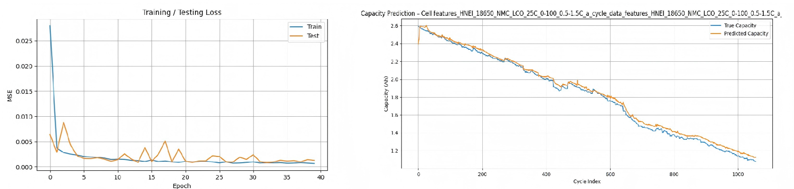
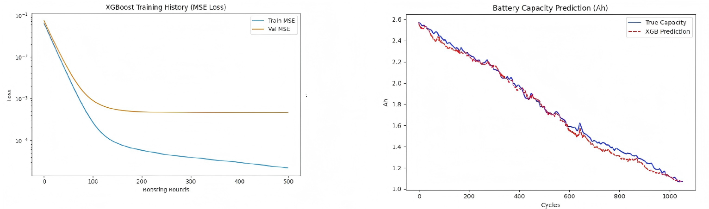
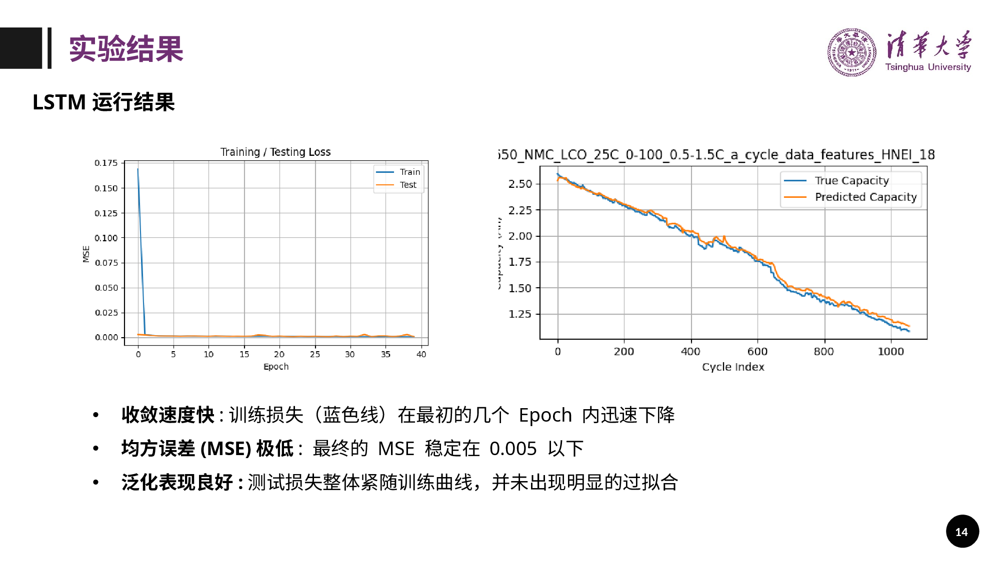
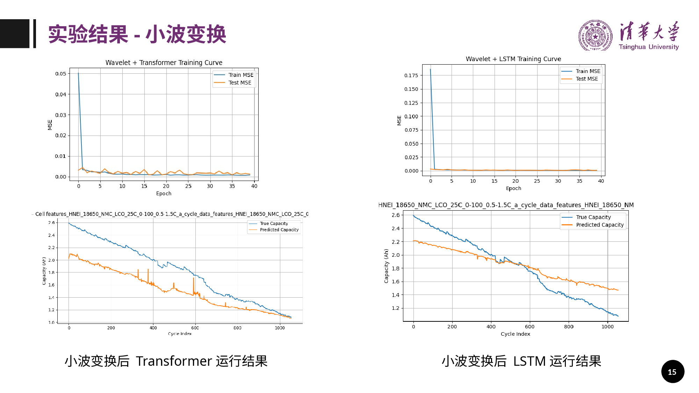

# 锂离子电池容量衰退预测（AI 数据驱动）

2025 年 12 月 BDMI 课程第六组项目，面向商用 18650 电池老化过程中的个体差异，比较 Transformer、LSTM 与 XGBoost 的容量预测表现，并分析 db4 小波预处理对预测曲线的影响。项目成员：周鹏程、朱冠儒。

**本仓库为研究成果展示与报告归档。** 当前材料包括报告、汇报幻灯片和结果图，未包含原始数据、训练代码、权重或逐次实验日志，不能直接复现训练。README 中的结论来自留存材料，本次未重新训练或计算指标。

## 项目方法

- 预测目标：循环放电容量；图中容量纵轴为 Ah。
- 模型对比：Transformer、LSTM、XGBoost，比较收敛情况、容量曲线拟合及局部变化响应。
- Transformer 流程（汇报描述）：每个 cycle 的统计特征 → 线性嵌入 → 位置编码 → Transformer Encoder → 最后时间步特征 → MLP 回归头 → 下一 cycle 容量。
- 小波实验：使用 Daubechies db4 进行信号分解与重构，比较预处理前后的 Transformer 与 LSTM 结果。

汇报还讨论倍率性能、增量容量曲线、电压/电流时序与内阻等候选特征，以及中值和卡尔曼滤波。由于没有训练代码，这些内容不等同于已确认全部用于最终实验的输入或预处理步骤。

## 留存结果

| 模型 / 处理 | 材料记载或图示观察 | 证据 |
| --- | --- | --- |
| Transformer | 汇报记载最终 MSE 低于 0.005；展示曲线能够跟随总体容量下降趋势 | PPT 第 12 页；下图 |
| LSTM | 汇报记载最终 MSE 低于 0.005；报告文字描述 MSE 为 10⁻³ 量级 | PPT 第 14 页；报告第 4 页 |
| XGBoost | 汇报描述训练与验证损失存在间隙，验证损失约 150 轮后进入平台期 | PPT 第 13 页；下图 |
| db4 + Transformer / LSTM | 展示曲线出现整体偏移或前低后高的偏差，未显示稳定改善 | PPT 第 15–16 页；下图 |

### Transformer



### XGBoost



### LSTM



### 小波预处理对比



结果图文件编号与 PPT 页码并不完全一致，上述对应关系已按内容核对。

## 结论与解释边界

在留存示例中，Transformer 和 LSTM 均表现出较低的损失，并能跟随总体容量下降趋势；小波预处理可能使曲线更平滑，但同时引入偏差。不能据此写成“小波变换稳定提升输入质量和预测精度”。

原报告提出 Transformer 长期趋势建模的优势，但当前材料缺少统一测试集的模型指标表、跨电芯验证、重复实验与统计检验，因此不将其写成已验证的“显著优势”。

MSE 的归一化方式、计算范围、单位与数据划分规则未完整留存；不能把图中的损失与容量曲线误差直接视为相同尺度，也不能将图示容量曲线认定为严格的未来外推预测。下一循环预测与跨越数百循环的长期外推是不同任务。没有原始预测值，本仓库未从图片估算新的精确分数。

## 文件结构

```text
README.md                   核实后的项目说明
docs/resume.md              修订后的简历文案
docs/evidence.md            证据对应及待补充材料
reports/report.pdf          原始课程报告
reports/presentation.pptx   原始课程汇报
reports/project.tex         原始报告 LaTeX 源稿
reports/fig/                四张模型结果图
```

可直接查看 [课程报告](reports/report.pdf)、[汇报文件](reports/presentation.pptx) 和 [简历文案](docs/resume.md)。LaTeX 源稿按原样归档，未重新编译；原有参考文献 PDF、自动生成的编译文件与带占位引用的第二版草稿未上传。

## 后续复现所需材料

补齐原始数据及来源、数据使用许可、电芯划分与时间划分规则、实际输入列、归一化参数、滑动窗口长度、模型超参数、训练代码与随机种子、真实值和预测值、db4 分解层数和阈值策略后，才可复核指标与模型对比结论。原始数据目录不可据图中标题直接推定。

## 使用说明

项目报告与幻灯片用于展示课程成果；本仓库未对这些材料额外授予开源许可证。第三方论文全文不随仓库再分发。
